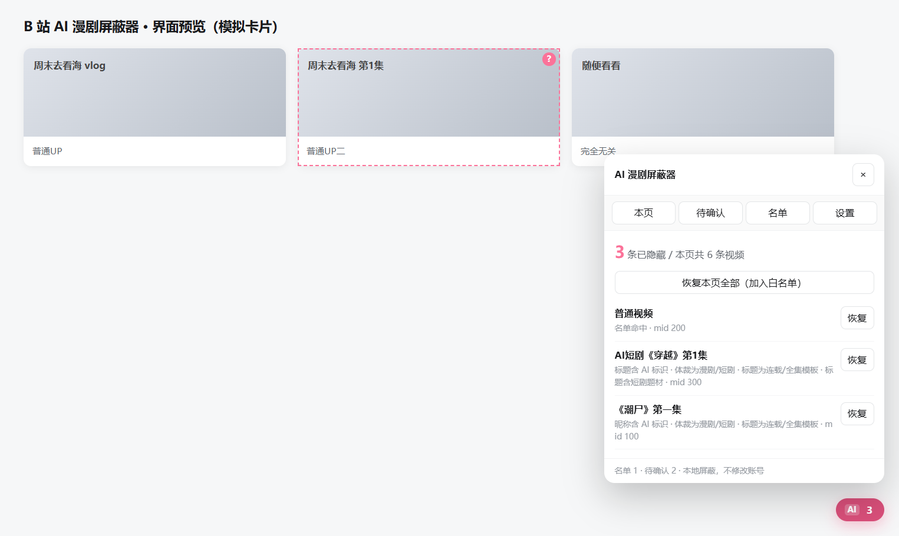

# Shut-Off-AI-Dramas · B 站 AI 漫剧屏蔽器

一个挂在 Tampermonkey / Violentmonkey 下的油猴脚本：在 **B 站首页推荐流**、**搜索结果页**、**动画分区（/c/douga/）** 里隐藏 AI 漫剧卡片，并把「发 AI 漫剧的账号」记成一份可导出、可分享的名单。

> 设计前提：自动识别分两层——明确 AI 标识，以及「剧场/短剧/漫剧」账号形态（会包含非 AI 动态漫，可在设置关闭）。剩下靠「一次标记、全站生效」和共享名单；**名单仍是最终解法，规则负责把明显的一批先清掉**。



## 功能

- 主页推荐流全部卡片自动隐藏：首屏服务端渲染的 `.feed-card`、Vue 水合与滚动追加的 `.bili-feed-card`（没有 `.feed-card` 包裹）都会处理，轮播占位区跳过。
- 搜索页 `.video-list` 结果同样生效。
- 动画分区 `/c/douga/` 的视频网格同样生效；顶部三行（`.head-cards` 网格，含轮播旁的卡片）也会处理，只跳过真正的轮播 slide。
- 鼠标悬停卡片时，左上角出现一个「屏蔽」按钮。
- 标记模式（快捷键 `M`）：点卡片即把该 UP 加入名单，`Esc` 退出。
- 名单按 `mid` 存储：在主页标记的账号，搜索页/分区页也会消失，反之亦然。
- 名单面板支持按名称排序、搜索昵称/mid、分页浏览，也可以手动粘贴 mid 或空间链接添加账号。
- 每个账号显示「已拉黑 / 未拉黑」，可单个拉黑、取消拉黑，或一键批量拉黑当前筛选结果里的未拉黑账号（调用 B 站官方「加入黑名单」接口，2 秒一个，可随时停止）。
- 待确认队列：规则自动命中的账号先进入这里，显示作者 mid、命中原因和视频标题，可以确认或标为误伤；支持「全部确认」。
- 搜索页可一键「把本页所有 UP 加入名单」，适合快速清理整页漫剧结果。
- 手动标记 / 导入 / 订阅的账号进入白名单逻辑：误伤可一键恢复。
- 名单导出为 JSON，可发群里、发网盘，或提交到仓库的 `list/ai-slop.json`。
- 内置仓库订阅地址，点「同步订阅」即可拉取仓库里的共享名单（当前 244 条）；同步只新增和转正，不会删除本地账号，也不影响本地规则。
- 自动低频读取公开的 UP 简介和视频标签，作为判定证据。

## 安装

1. 浏览器安装 [Tampermonkey](https://www.tampermonkey.net/) 或 Violentmonkey。
2. 打开扩展的「添加新脚本」，把 `dist/shut-off-ai-dramas.user.js` 的内容整体粘贴进去，保存。
3. 打开 `https://www.bilibili.com/`，右下角出现「AI」悬浮球即安装成功。

也可以直接点 GitHub raw 安装：

```
https://raw.githubusercontent.com/ZHIGENGNIAO258/Shut-Off-AI-Dramas/main/dist/shut-off-ai-dramas.user.js
```

raw 缓存没刷新时可用 jsDelivr 镜像：

```
https://cdn.jsdelivr.net/gh/ZHIGENGNIAO258/Shut-Off-AI-Dramas@main/dist/shut-off-ai-dramas.user.js
```

仓库：<https://github.com/ZHIGENGNIAO258/Shut-Off-AI-Dramas>

## 使用

### 主页 / 搜索页 / 动画分区

- 命中名单或高置信规则的卡片会直接收起，布局自动回流。
- 可疑卡片右上角出现 `?` 角标，只提示不隐藏。
- 悬停卡片 → 左上角「屏蔽」立即把该 UP 加入名单。

### 标记模式

按 `M` 或点悬浮球进入标记模式：

- 所有卡片出现描边，点击卡片即屏蔽该 UP，不会跳转。
- 再按 `M` 或 `Esc` 退出。
- 适合第一次使用时花两分钟刷一遍首页，把眼熟的 AI 漫剧号一次性收进名单。

### 面板

点右下角悬浮球打开：

- **本页**：本页隐藏了多少条、分别是谁，可逐条恢复或整页恢复。
- **待确认**：规则自动命中的账号，带 mid、命中原因和视频标题，可确认或标误伤；旧版本留下、没有标题样本的账号会显示占位提示，再次刷到同类卡片时自动补上。
- **名单**：按名称排序，支持搜索、分页、手动添加；每个账号显示「已拉黑 / 未拉黑」，可单个拉黑/取消拉黑，或批量拉黑当前筛选结果里的未拉黑账号；导出 / 导入 / 订阅、手动移除账号。
- **设置**：自动隐藏、角标、占位条、低频读取简介/标签、远程名单。

面板页脚会显示当前脚本版本号，方便确认是否已更新到最新版。

「恢复」会把账号加入白名单并写墓碑，远程名单 30 天内不会把它加回来。

拉黑需要已登录 B 站：单个拉黑立即生效；批量拉黑按每 2 秒一个串行执行，弹窗里显示进度并可随时停止；拉黑运行期间弹窗被锁定，点遮罩、× 或 Esc 都不会关闭（只会提示先停止），触发风控（-352）会自动停止。搜索页若提示网络错误，请回到 www.bilibili.com 操作。

拉黑状态只是本地标记：在 B 站取消拉黑后，脚本里仍显示「已拉黑」，点「取消拉黑」会同步调用接口并清除标记。

### 订阅共享名单

名单页里的订阅地址默认是仓库的 `list/ai-slop.json`，点「同步订阅」即可拉取（当前 244 条，全部为已确认条目）。同步规则：

- 只**新增**本地没有的账号，以及把本地「待确认」的同 mid 账号转正；
- 不会删除本地账号，不会覆盖本地人工记录，也不会关闭任何本地识别开关；
- 想用自己的名单，把地址换成别的 raw / jsDelivr 链接即可；清空地址就不再自动同步。

## 识别规则

规则分两层：**明确 AI 标识** + **漫剧/短剧账号形态**。第二层会顺带隐藏非 AI 的剧场/动态漫/短剧账号，默认开启，介意可在设置里关掉「识别漫剧/短剧生产号」。

| 信号 | 条件 | 分值 |
| --- | --- | --- |
| 昵称 AI | `AIGC`，或 `AI` + `漫剧/短剧/动漫/动画/剧场/影视/片场/创作/工作室` | +4 |
| 标题 AI | `AI漫剧/AI短剧/AI生成/AI制作/AI动画/AI影视/AIGC/人工智能生成/生成式` | +4 |
| UP 简介 AI | `AI创作/AI动画/AI漫剧/AIGC/人工智能生成/生成式` | +3 |
| 标签 AI | `AI`、`AIGC`、`AI动画`、`AI漫剧`、`AI视频`、`AI影视`、`AI作品`、`B站AI影视片场` | +3 |
| 体裁（明确） | `漫剧/短剧/动态漫/沙雕漫/剧集`（普通「第 N 集/合集」不再算体裁） | +2 |
| 账号名（强） | `剧场/短剧/漫剧/漫馆/制片厂/追漫/影业/好剧/番剧局/小剧场/漫剪/漫动画` | +3 |
| 账号名（弱） | `动漫/漫画/说漫/看剧/看漫/推剧/放映厅/听书/漫社/漫城/漫听/漫梗/国漫` | +2 |
| 强连载模板 | 跨季/跨集（`1-5季`、`第1~10集`）、`荃集/勉费/免废/无雾/未删减`、`一口气看完/追完`、`N小时合集`、`超前试看/独家限免` | +2 |
| 普通连载 | 单集 `第 N 集/话/季`、`EP N`、`完整版/全集/成片/合集/大结局/完结/抢先看/上集/下集` | +1 |
| 标签赛道 | `漫剧/短剧/动态漫/仿真人/AI真人/AI原创/AIGC/沙雕漫/2D漫/爆款短剧/热门漫剧/短剧推荐` | +3 |
| 题材 | `重生/穿越/逆袭/总裁/弃子/修仙/系统/师尊/复仇/千金/退婚/契约/闪婚/王妃/赘婿/战神/神医/龙王/反派/病娇/觉醒/异能/末世/末日/穿书/马甲/豪门/废土/丧尸/求生/绑定` 等 | +1 |
| 长剧情标题 | 去掉空格后 ≥24 字，且命中账号名/强连载/题材之一 | +1 |
| 简介赛道 | `漫剧/短剧/剧场/漫馆/每日更新/追更/充电` | +1 |
| 搜索页上下文 | 关键词含「漫剧/短剧」时，账号名命中 +2，其他赛道信号 +1 | +2 / +1 |
| 密度 | 同 UP 本页出现 ≥2 次，且已有 AI/漫剧倾向 | +1 |

- **≥4 分且通过强特征门槛**：高置信，自动隐藏并进入待确认。
- **强特征**（任一）：昵称/标签/简介自报 AI、剧场/漫剧类账号名、漫剧/短剧标签、明确体裁词、强连载模板、弱账号名 + 题材词。只有「标题带 AI + 普通单集」或「普通集数 + 题材 + 长标题 + 同屏」凑到 4 分的，封顶中置信，只打 `?`。
- **只有 AI 标识、没有漫剧/短剧特征时封顶为中置信**：例如「AI 全民制作人」发的 AI 动画短片、AI 绘画/音乐/活动回顾，即使分数够 4 也不自动隐藏。
- **2–3 分**：中置信，只打 `?` 角标。
- **硬否决**：`教程/教学/测评/入门到/从零/工具/软件/插件/脚本/编程/代码/部署/API/工作流/ComfyUI/大模型/AI绘画/论文`，以及 `陷阱/骗局/割韭菜/亏钱/内幕/揭秘/从夯到拉/锐评`（行业揭批类）直接判 0；`解析/技术/原理/模型/指南/行业/商业/访谈` 只在标题同时含 AI 语境时才否决。
- **负向**：`解说/影评/漫评/漫谈/杂谈/吐槽/拉片/盘点/混剪/reaction/复盘/剪辑/汉化组/字幕组/中文字幕/熟肉/生肉/烤肉/正式PV/剧场版/手书/MMD/广播剧/观影体/同人扶持计划/把玩/深度解析` 扣 4 分，避免把正统漫评、汉化组、特摄解析和同人二创当漫剧号。
- **官方白名单**：昵称以 `哔哩哔哩/腾讯视频/腾讯动漫/爱奇艺/优酷/芒果TV/快看漫画/央视/新华社/人民日报/CCTV/崩坏星穹铁道/崩坏3/原神/绝区零/明日方舟/王者荣耀` 开头直接 0 分。
- **昵称清洗**：抓取和导入时都会去掉 `· 昨天`、`· 12小时前`、`· 2025-11-14` 这类时间后缀，名单里不再出现脏名字。
- **低频增强**：首页/分区/搜索里的中置信卡片会按 2.5s 间隔读取视频标签和 UP 简介，命中 `漫剧/短剧/动态漫` 等标签后升级为高置信。
- 时长**不参与**判定：AI 短剧 5 分钟到 1 小时都有，和正常内容完全重叠。

规则阈值可以用 `test/core.test.mjs` 校准；改规则后先跑测试。

## 名单格式

```json
{
  "format": "bili-ai-slop",
  "version": 1,
  "updatedAt": "2026-11-14T00:00:00.000Z",
  "entries": [
    {
      "mid": 354399065,
      "name": "熊猫小圣AIGC",
      "confidence": "confirmed",
      "evidence": ["昵称含 AI 标识", "标签:AI影视片场"],
      "samples": ["《潮尸》第一集"],
      "addedAt": "2026-11-14"
    }
  ]
}
```

- `confidence`：`confirmed`（人工确认）或 `auto`（规则自动）。
- 导入时默认只导入 `confirmed`，勾选后才导入 `auto`。
- 订阅默认只信任 `confirmed`；远程条目只隐藏，不会触发任何账号操作。
- 校验规则在 `src/core.js` 的 `parseList`，也可以单独跑 `node scripts/validate-list.mjs`。

## 隐私与边界

- 所有数据存在脚本管理器本地（`GM_setValue`），不上传任何服务器。
- 只读增强只调用 B 站公开 GET 接口（`card?mid=`、`view/detail/tag?bvid=`），`credentials: "omit"`，不携带 Cookie，不调用任何写接口。
- 订阅只发起一次普通的 HTTPS GET 拉取 JSON 名单（默认是 GitHub raw），不带 Cookie，不上传本地名单。
- 拉黑只在你点击「拉黑 / 批量拉黑」时执行，调用 B 站官方关系接口（`x/relation/modify`），需要已登录并携带 CSRF；脚本不会自动拉黑，也不会举报、封禁或修改其他账号状态。
- 拉黑状态只记录在本地（`blocked` 字段），不写进导出的名单，也不会随订阅分发。
- 覆盖网页版首页、搜索页、动画分区（`/c/douga/`），不覆盖手机 App。
- 不识别封面内容（不做 OCR / 视觉模型），只根据标题、昵称、简介、标签判断。
- B 站改版可能导致选择器失效，届时需要更新 `src/surfaces.js`。

## 开发

```bash
npm install
npm test          # 规则 + 存储 + jsdom 适配 + 构建产物集成测试（73 项）
npm run build     # 生成 dist/shut-off-ai-dramas.user.js
npm run verify    # 测试 + 构建 + 名单校验
npm run demo      # 生成 docs/demo.html 界面预览（模拟卡片，无真实数据）
```

目录：

```
src/core.js       规则、评分、否决、名单校验与合并
src/surfaces.js   主页/搜索页适配
src/api.js        只读增强（UP 简介 / 标签），限速与缓存
src/store.js      GM 存储、名单操作、迁移
src/dom.js        隐藏 / 角标 / 标记模式
src/ui.js         悬浮球、面板、导入导出
src/main.js       启动、观察器、扫描、路由
src/panel.css     界面样式
build.mjs         拼装单文件用户脚本
list/ai-slop.json 共享名单
scripts/validate-list.mjs 名单校验
scripts/demo.mjs  生成界面预览
docs/             预览截图与生成的 demo
test/             单元测试与 jsdom 集成测试
```

## 免责声明

这是一个本地内容过滤工具，用来减少自己在信息流里看到的 AI 漫剧内容，不针对任何具体创作者。共享名单请只收录**自己确认过**的账号，并保留证据；误伤请在面板里标为「误伤」，脚本会把账号加入白名单并写墓碑。使用本脚本产生的任何后果由使用者自行承担。

## License

MIT


